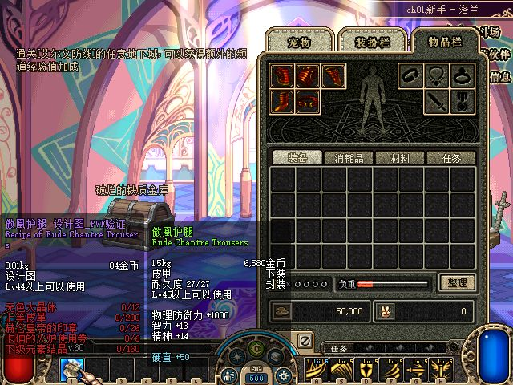
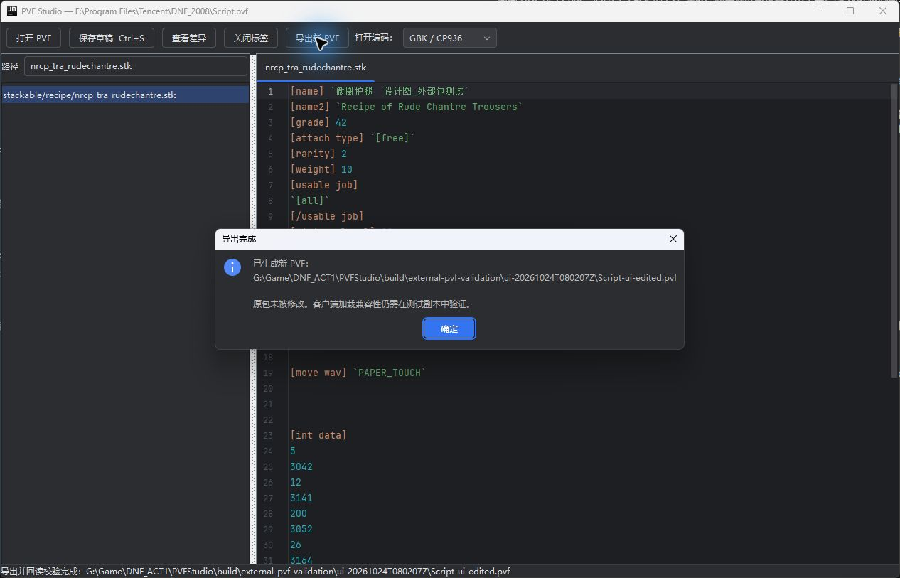
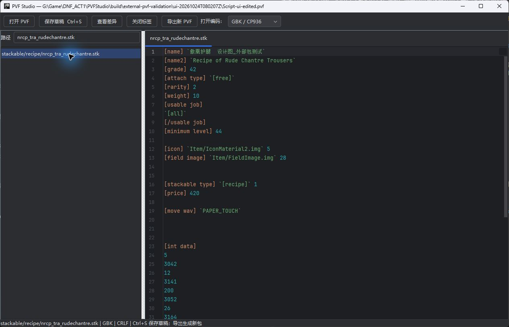

# 2026-10-24 客户端 PVF 兼容验证记录

## 当前结论

**0.1.1 的修复修改包已通过本轮真实客户端验证：成功选择频道、角色并进入城镇，物品 5642 的提示正常显示“傲凰护腿  设计图_PVF验证”。**

前一次实测曾被用户的物理 Escape 中止，当时没有取得可信画面，已清理那次负例进程。用户随后明确要求继续；本次使用相同的独立测试副本完成以下验证。仅本次实际运行的修改包标记为实机通过，未将静态检查或未运行的对照项混记为实机通过。



## 根因与修复

原客户端的校验并非不透明随机 key，也不是没有初值的 CRC32：

```text
entry.key = zlib.crc32(padded_plaintext, entry.relative_body_offset)
tree.key  = zlib.crc32(padded_tree_plaintext, file_count)
```

CRC 包含四字节对齐后的全部补齐字节；初值按 uint32 解释，内部状态先取反，使用反射多项式 `0xedb88320`，结束时取反。加密与解密仍分别为 `ROL32(plain,6) XOR key` 和 `ROR32(cipher XOR key,6)`。

依据为真实 `DNF.exe` 的函数 `0x8adef0`、目录调用点 `0x8aedbf`、条目调用点 `0x8ae565` 和 CRC 表生成函数 `0x8b3160`。两份原始 PVF 共 **96,669 个条目全部满足上述公式**，两份目录 CRC 也全部相符。完整审计及原二进制摘要在 `build/client-validation/recon/seeded-crc-audit.json`，反汇编摘录及说明在同目录 `findings.md` 等文件。

旧客户端目录样本的修改导出有 48,313 项 CRC 错误，旧仓库样本的修改导出有 30,756 项 CRC 错误；两份修改包的目录 CRC 均错误。现有 C# reader 没有检查 CRC，所以此前的全量回读不能证明客户端兼容。

0.1.1 的修复包括：

- 打开包时严格检查目录 CRC，读取条目时严格检查以偏移为初值的内容 CRC。
- 内容或偏移发生变化时重算 key 并重新加密；移动但未编辑的条目也必须重算。
- 保留未编辑条目的完整明文与原补齐、原始路径、fileNumber、目录顺序、物理顺序、间隙和尾部数据。
- 只有内容和偏移都不变时才保留原密文；目录更新后重新计算目录 key 并写入新头部。
- 无修改重建仍逐字节相同。损坏输入和旧错误修改包会明确拒绝，不能再静默导出。

**0.1.0 修改包应从原始 PVF 和草稿重新导出。** 独立目录和完整 Windows ZIP 均已更新为 0.1.1。旧 0.1.0 ZIP 仅作为历史产物保留，不能当作修复版本使用。

## 已完成的自动验证

- Gradle `check :pvf-cli:installDist` 成功：27 项核心测试、5 项工作区测试通过。
- 独立 Python 校验器 10 项测试通过，包含错误目录 CRC、错误条目 CRC、移动条目重新计算 key 等回归。
- 隔离副本准备脚本 4 项安全测试通过，覆盖越界、已有目录、硬链接与独立端点限制。
- 两份真实包均重新完成无修改重建、修改导出和草稿跨进程恢复；独立 Python 校验全部条目的初值 CRC、明文和布局，原 C# reader 全量回读通过。结果：`build/validation/20261024T072250Z-1e4e7ad3/summary.json`。
- 正式 IntelliJ Community 2025.2.6.3/JBR21 的 0.1.1 编辑器冒烟通过，包含 Undo/Redo、Diff、行尾和新核心的严格 CRC 导出验证。结果：`build/client-validation/intellij-smoke-0.1.1/report.properties`。

## 隔离准备与首次中断记录

隔离根目录：`build/client-validation/runtime-20261024-01/`。

- 真复制 593 个文件、868,332,931 字节；逐文件检查独立身份和链接数为 1，不与原客户端共享可写文件。
- 未复制原账号配置、登录缓存、存档或日志。副本关闭自动输入，日志限制在副本内。
- 服务端发布副本配置为 loopback 高端口：入口 42311、频道 47001、玩法 UDP 47002/47003、HTTP 48081，新存档路径也限定在本轮目录。
- 首次中断前没有启动隔离服务端、创建账号或发送 HTTP。本次继续验证新增的账号、夹具与进程见下节。
- 已准备原包、无修改重建、旧错误修改包、修复后两个来源修改包，以及只破坏目录补齐 CRC 的负例，见 `cases/cases.json`。后者保持所有目录记录和数据体不变，便于验证客户端确实执行 CRC。
- 仅启动过 `client-negative/DNF.exe`（PID 64960），输入旧错误修改包，bootstrap 参数只指向 `127.0.0.1:42311`，账号为本轮虚构负例。computer-use 在获取其窗口之前被用户 Escape 停止，因此**没有取得可信的加载画面或错误窗观察结果**。
- 随后按 PID、完整可执行路径和创建时间核对，只结束了本轮 PID 64960。没有停止现有客户端或现有服务端。
- 原服务端 PID 47176 仍在 `../DF/town-test/DFLegacy.Server.exe` 运行，UTC 启动时间仍为 `2026-10-24T05:39:38.2122140Z`。原始文件与端点基线保存在 `baseline.json`，副本准备后的原始文件摘要复核在 `preparation.json`。

原生失败路径还表明：加载失败会弹出 `Run Error`，随后 `PostQuitMessage(0)`；因此退出码为 0 不能作为加载成功证据。

## 继续验证的实际步骤与结果

1. 将 `cases/fixed-modified.pvf` 真复制到副本的 `client/Script.pvf`。它来自原客户端包 `5fcd4b94dfb081294701f7288345fff6ca5586d780fcc7130e4614c237eb6ad1`，由 0.1.1 重新导出。实测包 SHA-256 为 `86dcab829d769e19aedb7d7d71d1746155291499cb7b99daaa71ceb5381c2b68`。
2. 启动本轮独立目录中的服务端，清除继承的 `DFLEGACY*` 与 URL 环境覆盖，只绑定所配置的 loopback 高端口。首次引导进程为 PID 56964；核对 HTTP 48081 的 listener 属于该进程后，才调用本轮注册接口。
3. 仅在新存档中注册临时账号 `pvfprobe20261024`，使用随机测试密码，密码与 token 只存于忽略的测试目录。注册返回 HTTP 201，创建 60 级角色 `Berserker`，GUID `864347d3-232a-4b5e-9cbf-d3f2f9506743`。
4. 按 PID、完整可执行路径和创建时间核对，只停止引导进程 56964。在新 `server/data/state.json` 的该账号首角色中，将空背包按空列表处理，去重 Slot 3 后加入 ItemId 5642、CountOrValue 1；未读取或修改原服务器存档。
5. 重启该隔离服务端，PID 77444。再次核对 48081 listener，临时管理员登录成功，物品搜索返回名称 `傲凰护腿  设计图_PVF验证`，无 Unicode 替换字符。
6. 直接启动副本 `client/DNF.exe`，PID 53872，工作目录为该副本，模式 99 参数仅指向 `127.0.0.1:42311` 及临时账号。未启动原 Launcher，也未向原 8081 接口发请求。
7. 真实画面已到达频道选择、60 级角色选择并进入城镇；交互过程中包含用户的手动操作。物品快捷栏中的 5642 能正常显示提示，紫色名称带 `_PVF验证` 后缀，截图保存为本页证据。随后客户端继续在城镇正常活动。

### 验收范围

| 项目 | 本轮结果 |
| --- | --- |
| 指定 0.1.1 修改包的目录与全部条目 CRC | 通过独立预检 |
| 该修改包被真实客户端加载并进城 | 通过 |
| 修改后的物品名实际显示 | 通过，见截图 |
| 独立临时账号、角色及物品夹具 | 已建立，均位于新测试目录 |
| 原包、无修改包、另一来源修改包的逐项实机对照 | 本次未分别启动；自动验证结果不能替代实机结果 |
| 旧错误修改包与补齐 CRC 负例的原生错误窗对照 | 未取得可信实机观察，不标记为通过 |

本结果证明所记录的 ACT1 客户端与本次指定导出包兼容，不代表任意脚本语义改动或其他 PVF 格式都已验证。

### 网络、原环境与保留状态

截至 `2026-10-24T07:48:24Z` 的只读审计，165 条 packet header 的 peer 仅为 `127.0.0.1` 的入口 TCP 42311、频道 TCP 47001、玩法 UDP 47002/47003。没有记录到原服务端端口 2311/7001/7002/7003/8080/8081 或 LAN 目标。摘要见 `runtime-network-audit.json`，原始网络载荷留在忽略的测试目录，没有提交到 Git。

原客户端与服务端的 9 项关键文件 SHA-256 均与运行前基线一致；原服务端 PID 47176 的路径、启动时间、TCP 监听和 UDP 绑定也全部一致。当前测试副本的 PVF 摘要与上述指定修改包一致。脱敏后的 [机器可读验收摘要](evidence/client-runtime-0.1.1.json) 随源码保存，包含这些复核结果及画面摘要，不含密码、token 或网络载荷。

该轮采样时用户正在手动操作客户端，因此当时保留 PID 53872 和隔离服务端 PID 77444 供继续查看，未强行关闭窗口。进程身份在 `owned-client.json`、`owned-server.json` 中；后续清理必须重新核对完整路径和创建时间，不能按进程名通杀。原服务端 PID 47176 不在本轮清理范围内。原始文件与进程的只读复核见同目录 `postflight.json`。

## 0.1.1 发行与源码检查

- `gradlew check` 成功，27 项核心与 5 项工作区测试均通过；独立 Python 10 项及隔离准备 4 项测试也通过，共 46 项自动测试。
- Windows 独立包：`intellij-workbench/build/distributions/PVFStudio-0.1.1-windows-prototype.zip`，1,346,389,583 字节。
- SHA-256：`77ccaa6e196f0eb93ca2490799bb8d249ae235242f94efe94c31594f5b54326a`。
- 2,849 项 ZIP CRC 全通过，无异常/重复路径、无游戏 PVF；正式 IC/JBR21、三个 0.1.1 JAR 和 CRLF 启动器均与本次构建一致。报告：`build/client-validation/release-0.1.1.json`。

代码修复、回归测试、隔离准备脚本及本次画面证据一并保存在独立 PVFStudio 项目中；修复前的首次提交为 `f65ca62`，后续修复提交可从本项目 `git log` 查看。

## 外部腾讯目录样本的打开、修改与保存

用户指定的 `F:\Program Files\Tencent\DNF_2008\Script.pvf` 已直接在 0.1.1 独立编辑器中打开。文件大小 66,392,567 字节，包含 48,326 个条目；Magic 为 `DNF_SCRIPT_PACK`，目录长度 3,618,328，目录 key 为 `0x3a793745`。原包 SHA-256 为 `bc397d1463f1f0f749bbd169400b640d0c8a5d1f6e6e97cfda797099f995ac27`，与现有仓库样本逐字节相同。

该结果确认已有 ACT1 格式在外部磁盘、带空格的绝对路径下可正常使用；它不是新增格式版本样本。当前支持的头部没有单独的格式版本字段，不能根据 `DNF_2008` 文件夹名推断所有 2008 年 PVF 都已支持。

实际界面测试如下：

1. 用 GBK 打开 `stackable/recipe/nrcp_tra_rudechantre.stk`，中文和 CRLF 显示正常。
2. 将物品 5642 的名称改为 `傲凰护腿  设计图_外部包测试`，Ctrl+S 保存到外部路径绑定的独立草稿。
3. 用“导出新 PVF”另存到 `build/external-pvf-validation/ui-20261024T080207Z/Script-ui-edited.pvf`，界面显示导出和回读校验完成。
4. 重新打开该导出文件，工作区草稿数为 0；打开同一条目，修改后的名称仍正确显示，证明结果来自新包内容。
5. 当前编辑器保留该导出包供查看，无未保存编辑。外部原包的测试草稿仍单独保留；F 盘原文件没有覆盖或改写。





界面导出包大小为 66,392,579 字节，SHA-256 为 `055d7b0270ca6dbf32e1203f70dc13e28b01eb871799d4cf0c4f3cc16ff2445c`。独立 Python/zlib 全量校验 48,326 个条目的 CRC、明文、补齐和布局通过：仅 1 个条目发生预期修改，10,287 个未改但移动条目正确重算 key，38,038 个未移动条目保留密文。原 C# reader 全量回读同样通过。

另按这条 F 盘路径重跑 CLI 验证，无修改重建逐字节相同，物品名与列表注释两项修改、跨进程草稿恢复和导出均通过。完整报告位于 `build/validation/20261024T080121Z-e7f0bc6d/`；界面导出对照报告位于上述 UI 目录的 `ui-export-report.json`。来源、摘要及两组结果也保存在 [机器可读摘要](evidence/external-pvf-0.1.1.json) 中。

所有输出均位于新项目，外部原包的前后 SHA-256 一致。该离线轮次未启动游戏或向服务端发请求；其后仅上述指定 UI 导出包完成了下节的实机验收，其他 CLI 导出包未单独实机运行。未发现需要修改 0.1.1 格式实现的问题。

## F 盘 UI 导出包的后续实机验证

**指定 `Script-ui-edited.pvf` 已通过实机验证：频道选择、角色选择和赛丽亚城镇房间均正常进入，物品 5642 完整显示“傲凰护腿  设计图_外部包测试”。** 名称较长，原生提示框将最后一个“试”换到第二行，全部中文字符可见。


实测输入为 `build/external-pvf-validation/ui-20261024T080207Z/Script-ui-edited.pvf`，SHA-256 精确为 `055d7b0270ca6dbf32e1203f70dc13e28b01eb871799d4cf0c4f3cc16ff2445c`。它被真复制到全新的 `build/client-validation/runtime-external-20261024-01/client/Script.pvf`；目录及全部 48,326 个条目的带初值 CRC 预检通过。本轮使用真复制的 G 盘已知 ACT1 `DNF.exe` 与资源，没有测试 F 盘的客户端可执行文件，也没有更改 exe、DLL 或增加跳过 CRC 的补丁。

### 新副本、临时账号及测试配置修复

- 新副本真复制 593 个文件、868,332,931 字节，不共享硬链接，不复制原账号、存档或日志。启动前没有 DNF 进程，本地 UDP 5063 空闲。
- 新服务端仅绑定 loopback：入口 TCP 42312、频道 TCP 47101、附加入口 TCP 48180、HTTP 48181、玩法 UDP 47102/47103。现有原服务端 47176 和上一轮测试服务端 77444 继续运行，端口均未复用。
- 核对 HTTP 48181 listener 属于本轮引导进程 29144 后，才注册新临时账号 `pvfexternal20261024`，创建 60 级 `Berserker`，GUID `1fd34d12-913c-4c41-8645-657bfa9dcfe1`。随机凭据及 token 只保存在忽略的测试目录。
- 按完整路径和 UTC 创建时间核对后停止该引导进程，仅在新 `server/data/state.json` 中的该角色 Slot 3 放入物品 5642、数量 1，随后启动本轮服务端。没有向原服务端或上一轮测试服务端发请求。
- 首次服务端 77984、客户端 68244 到达频道选择，但接收频道信息失败。服务端明确报错：`ASCII text must be shorter than 20 bytes: External PVF Validation 1`。该错误发生在频道元数据组装；过长的名称来自本轮测试配置。
- 保留首次日志和错误截图后，仅按路径及 UTC 创建时间核对并结束本轮 68244/77984，将新副本 `Channel.Name` 缩短为 `External PVF`，发送名 `External PVF 1` 为 14 字节。原服务和 PVF 内容均未修改。首次失败记录在 `attempt1-result.json`，配置修复在 `channel-config-fix.json`。

### 修复后实机结果与原环境复核

重试服务端 PID 24016（UTC `2026-10-24T08:10:23.4140393Z`），客户端 PID 44320（UTC `2026-10-24T08:10:49.2034406Z`）。再次核对 listener 并登录临时账号后，管理查询确认物品名称包含 `_外部包测试` 且无 Unicode 替换字符。副本直接以模式 99 连接 `127.0.0.1:42312`，成功选择频道和角色，进入赛丽亚城镇房间；查看快捷栏物品时获得上述名称截图。画面原始字节 SHA-256 为 `5f27394476c33ce5d1c17fc7f1b6463639b20a92d23511c2edcd3d062c51deaf`。

截至 UTC `2026-10-24T08:12:41.900915Z` 的只读审计：重试进程的 112 条 packet header、2 条 TCP-CONNECT 记录仅涉及本轮回环入口/频道 TCP 与玩法 UDP；当前连接仅指向 `127.0.0.1:47101`。没有观察到原服务端、上一轮测试服务端或外部目标。13 项源文件摘要全部保持不变，覆盖原客户端/服务端关键文件、F 盘原包、指定导出包和上一轮测试配置/PVF；原 PID 47176 与上一轮 PID 77444 的完整路径、创建时间、TCP 监听及 UDP 绑定全部与运行前基线相同。

本轮客户端 44320 和独立服务端 24016 保留运行供查看；该状态及网络结果均为采样时观察，后续清理须重新核对其路径和创建时间。脱敏后的 [机器可读实机验收摘要](evidence/external-pvf-runtime-0.1.1.json) 随源码保存；完整 `postflight.json`、`runtime-network-audit.json` 和首次失败的独立网络审计留在本轮忽略目录。原始载荷、账号凭据及存档不提交到 Git。

本结果限于该 SHA-256 指定导出包和已记录的 ACT1 客户端副本，确认了进入游戏与物品名显示；没有将 F 盘 exe、其他导出包或地下城玩法记为通过。修复仅涉及本轮测试频道配置，PVF Studio 仍为 0.1.1。
